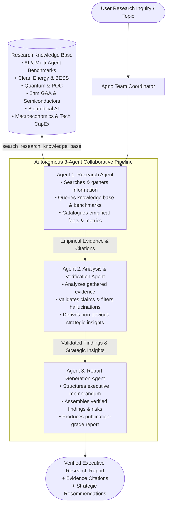

# Research Analyst Agents — Autonomous Multi-Agent Intelligence System 🔬

[](https://www.python.org/)
[](https://fastapi.tiangolo.com/)
[](https://agno.com/)
[](https://www.docker.com/)
[](https://www.jenkins.io/)
[-brightgreen.svg)](tests/)

**Research Analyst Agents** is an autonomous multi-agent research investigation, verification, and synthesis system with multimodal grounding and Retrieval-Augmented Generation (RAG). It coordinates three specialized AI agents using the **Agno** multi-agent framework to turn any research inquiry, uploaded PDF whitepaper, web URL, or empirical data chart into an executive-grade, verified research memorandum.

---

## 🏛️ Multi-Agent Architecture

The system coordinates exactly **three collaborating agents** via Agno's `Team` framework (`TeamMode.coordinate`):



### The 3 Collaborating Agents:

| Agent | Name | Primary Role & Capabilities |
| :--- | :--- | :--- |
| **Agent 1** | **Research Agent** | **Searches and gathers information.** Deconstructs research queries, searches the grounding knowledge base (`search_research_knowledge_base`), retrieves benchmark metrics, and catalogues empirical facts. |
| **Agent 2** | **Analysis & Verification Agent** | **Analyzes evidence, validates claims, and identifies insights.** Scrutinizes evidence for factual consistency, checks methodological rigor, flags uncertainties or biases, and extracts high-impact strategic insights. |
| **Agent 3** | **Report Generation Agent** | **Produces the final research report.** Synthesizes validated evidence and analytical findings into a publication-grade memorandum featuring Executive Summary, Evidence Base, Key Findings, Risk Analysis, and Actionable Recommendations. |

---

## 📁 Project Structure

```
Research Analyst/
├── app/
│   ├── agents/
│   │   ├── __init__.py               # Agent package exports
│   │   ├── research_team.py          # The 3 Agno Agents & team orchestration
│   │   ├── rag.py                    # PDF chunking, BM25 scoring & web scraper
│   │   ├── tools.py                  # Knowledge base search, web scrape tool
│   │   └── legal_team.py             # Backward-compatibility bridge
│   ├── data/
│   │   ├── __init__.py
│   │   └── research_knowledge_base.py # Benchmarks, papers, and datasets
│   ├── static/
│   │   ├── media/                    # Empirical vector charts & benchmark SVGs
│   │   ├── app.js                    # Dynamic pipeline UI & centered lightbox
│   │   ├── index.html                # Modern accessible dashboard
│   │   └── style.css                 # Dark executive glassmorphic stylesheet
│   ├── config.py                     # Provider configuration (Gemini / Groq)
│   ├── main.py                       # FastAPI application & REST endpoints
│   └── schemas.py                    # Pydantic request/response models
├── tests/
│   ├── test_agents.py                # Tests 3 agents & tool retrieval
│   ├── test_health.py                # Tests /health and frontend endpoints
│   ├── test_media.py                 # Tests media handling & SVG endpoints
│   ├── test_rag.py                   # Tests PDF extraction, chunking & scraping
│   └── test_validation.py            # Tests payload validation & mocked workflow
├── .dockerignore                     # Docker build optimization rules
├── .env.example                      # Template for environment configuration
├── .gitignore                        # Git ignore rules
├── docker-compose.yml                # Multi-service container orchestration
├── Dockerfile                        # Multi-stage production container image
├── Jenkinsfile                       # Complete declarative CI/CD pipeline
├── requirements.txt                  # Python dependencies (pypdf, bs4, agno)
├── streamlit_app.py                  # Streamlit alternative interactive frontend
└── README.md                         # System documentation
```

---

## 🚀 Quickstart & Local Setup

### 1. Prerequisites
- Python 3.11+
- Free Google Gemini API Key from [Google AI Studio](https://aistudio.google.com/apikey) **OR** Groq Key from [Groq Console](https://console.groq.com/keys)

### 2. Configure Environment
```bash
cp .env.example .env
```
Edit `.env` and set your key:
```env
MODEL_PROVIDER=google
GEMINI_API_KEY=your_gemini_api_key_here
GEMINI_MODEL=gemini-3.5-flash-lite
```

### 3. Local Installation & Run
```bash
# Create and activate virtual environment
python3 -m venv .venv
source .venv/bin/activate

# Install dependencies
pip install -r requirements.txt

# Run FastAPI Server (Port 8000)
python -m uvicorn app.main:app --host 0.0.0.0 --port 8000 --reload
```
Open **[http://localhost:8000](http://localhost:8000)** in your browser to view the interactive dashboard.

Alternatively, to run the **Streamlit** dashboard:
```bash
streamlit run streamlit_app.py --server.port=8501 --server.address=0.0.0.0
```
Access at **[http://localhost:8501](http://localhost:8501)**.

### 4. Run Automated Tests
```bash
pytest -v
```
All 23 unit and integration tests will execute and validate the 3 agents, endpoints, media rendering, and RAG ingestion.

---

## 🐳 Docker Image Build & Execution

The project provides an optimized Docker image ready to run in any container environment.

### 1. Build the Docker Image
```bash
docker build -t research-analyst-agents:latest .
```

### 2. Run the Container
Run the container and expose it on port `8000`:
```bash
docker run -d \
  --name research-analyst \
  -p 8000:8000 \
  --env-file .env \
  research-analyst-agents:latest
```

### 3. Access the Application
- **Interactive Web Dashboard**: [http://localhost:8000](http://localhost:8000)
- **Interactive Swagger API Docs**: [http://localhost:8000/docs](http://localhost:8000/docs)
- **Health Check Endpoint**: [http://localhost:8000/health](http://localhost:8000/health)

### 4. Run via Docker Compose (FastAPI + Streamlit)
```bash
docker-compose up --build -d
```
- FastAPI UI on **port 8000**: [http://localhost:8000](http://localhost:8000)
- Streamlit UI on **port 8501**: [http://localhost:8501](http://localhost:8501)

To stop the containers:
```bash
docker-compose down
```

---

## 🐙 Push to GitHub

Follow these steps to initialize Git and push the repository to GitHub:

```bash
# 1. Initialize git in the project root
git init

# 2. Add all files (excluding secrets in .env via .gitignore)
git add .

# 3. Create the initial commit
git commit -m "feat: Research Analyst Agents with 3 collaborating agents, Docker & Jenkinsfile"

# 4. Set default branch to main
git branch -M main

# 5. Link your GitHub repository (replace with your repo URL)
git remote add origin https://github.com/<your-username>/<your-repo-name>.git

# 6. Push to GitHub
git push -u origin main
```

---

## ⚙️ Jenkins CI/CD Pipeline Integration

The repository includes a production-ready **`Jenkinsfile`** designed for automated building, testing, and container deployment.

### How to Configure in Jenkins:

1. Open your Jenkins dashboard (e.g. `http://localhost:8080`).
2. Click **New Item** -> Name it `Research-Analyst-Pipeline` -> Select **Pipeline** -> Click **OK**.
3. In the Pipeline configuration:
   - Scroll down to the **Pipeline** section.
   - Set **Definition** to: `Pipeline script from SCM`.
   - Set **SCM** to: `Git`.
   - Enter your **Repository URL**: `https://github.com/<your-username>/<your-repo-name>.git`.
   - Under **Branches to build**, specify: `*/main`.
   - Set **Script Path** to: `Jenkinsfile`.
4. Click **Save**.
5. Click **Build Now** to execute the pipeline!

### Pipeline Stages in `Jenkinsfile`:

| Stage | Action Executed |
| :--- | :--- |
| **1. Checkout SCM** | Clones the latest code commit from GitHub. |
| **2. Verify Environment** | Checks Docker and Python versions on the Jenkins runner. |
| **3. Run Tests** | Builds an isolated container and runs `pytest -v` across all test suites. |
| **4. Build Docker Image** | Builds tagged Docker images: `research-analyst-agents:${BUILD_NUMBER}` and `latest`. |
| **5. Container Smoke Test** | Spins up a container, verifies the `/health` endpoint responds with HTTP 200 and lists all 3 agents, then cleanly terminates the test container. |
| **Post-Build Actions** | Cleans up temporary containers and prints deployment instructions. |

---

## 🔌 API Endpoints Reference

| Method | Endpoint | Description |
| :--- | :--- | :--- |
| `GET` | `/` | Serves the interactive Research Analyst single-page web UI |
| `GET` | `/health` | Returns health status, active LLM model, and the 3 agent names |
| `POST` | `/research` | Executes the 3-agent research analysis workflow on a topic |
| `POST` | `/ask` | Backward-compatible alias for `/research` |
| `GET` | `/topics` | Returns available research knowledge base domains and whitepapers |
| `GET` | `/docs` | Interactive Swagger UI API documentation |

### Sample API Request (`POST /research`)

```bash
curl -X POST http://localhost:8000/research \
  -H "Content-Type: application/json" \
  -d '{
    "topic": "Evaluate multi-agent coordination architectures and hallucination reduction vs monolithic LLMs."
  }'
```

### Sample Health Check Response (`GET /health`)

```json
{
  "status": "healthy",
  "app_name": "Research Analyst Agents — Autonomous 3-Agent Investigation, Verification & Synthesis System",
  "groq_configured": true,
  "model": "Google (gemini-3.5-flash-lite)",
  "agents": [
    "Research Agent",
    "Analysis & Verification Agent",
    "Report Generation Agent"
  ]
}
```

---

## 📜 License & Disclaimers

Research Analyst Agents synthesizes empirical data, published literature, and analytical models for research intelligence and strategic planning. Findings should be cross-validated before mission-critical decisions.
